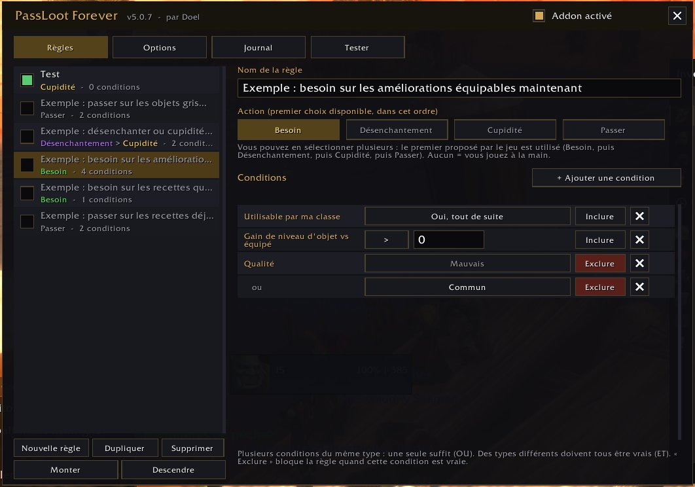
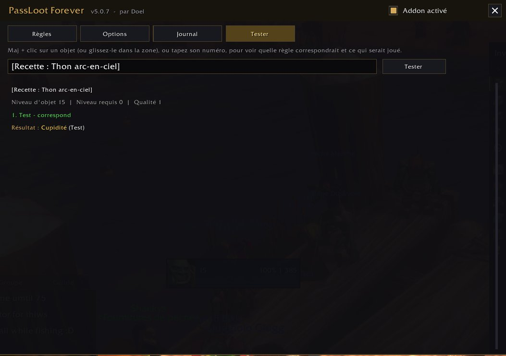
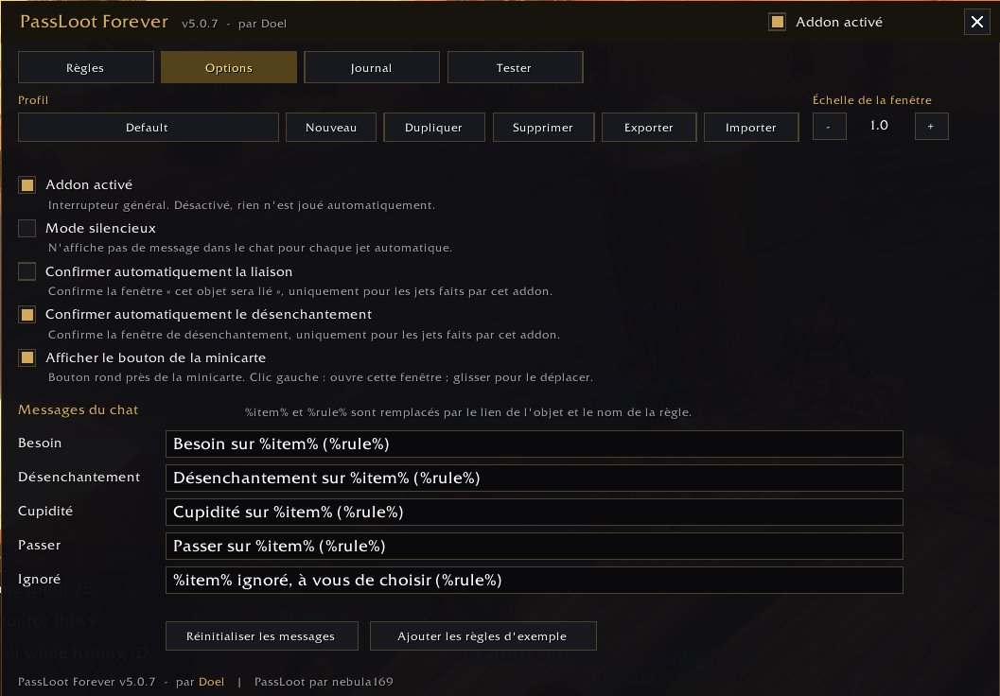

# PassLoot Forever - Mode d'emploi

[English](USER_GUIDE.md) | Français

PassLoot Forever joue **à votre place** Besoin, Désenchantement, Cupidité ou Passer quand un objet tombe en groupe,
selon des règles que vous écrivez une fois pour toutes. Un souci, une idée ? Dites-le-moi !

## 1. Installation

1. Fermez le jeu.
2. Décompressez l'archive et copiez le dossier **PassLootForever** dans le dossier **AddOns** de votre client
   WoW Forever (là où se trouvent vos autres addons).
3. Lancez le jeu. Dans l'écran de sélection du personnage, vérifiez que « PassLoot Forever » est coché dans la liste des addons.

## 2. Premier lancement : à faire avant tout

1. Tapez **/plf diag** dans le chat. L'addon vérifie que les fonctions de jet de butin existent sur votre client.
   Si une ligne est en rouge (« missing »), faites une capture d'écran et envoyez-la moi : c'est la chose la plus utile pour moi.
2. Pour voir les éventuelles erreurs, tapez **/console scriptErrors 1** (à remettre à 0 ensuite si les fenêtres d'erreur vous gênent).
3. Tapez **/plf** pour ouvrir la fenêtre. L'addon est aussi accessible via **Options > onglet AddOns > PassLoot Forever** ou par le **bouton de la minicarte** (clic gauche).

L'addon est en anglais par défaut, et entièrement traduit en français sur les clients en français (frFR).

## 3. Créer sa première règle (2 minutes)

Exemple : **passer automatiquement sur tous les objets gris et blancs.**

1. Onglet **Règles**, bouton **Nouvelle règle**. Tapez un nom, par exemple « Passer sur le gris et blanc ».
2. Dans **Action**, cliquez sur **Passer** (le bouton devient doré).
3. Cliquez sur **+ Ajouter une condition**, choisissez **Qualité**, puis choisissez **Médiocre** dans la liste.
4. Ajoutez une deuxième condition **Qualité** et choisissez **Commun**.
5. C'est tout : la règle s'applique aux objets de qualité médiocre **ou** commune.

Quelques points à retenir :

- **Plusieurs actions** peuvent être cochées : l'addon prend la première que le jeu propose, dans l'ordre
  Besoin, puis Désenchantement, puis Cupidité, puis Passer. Aucune action cochée = vous jouez à la main.
- **Plusieurs conditions du même type** (deux « Qualité ») : une seule suffit (**OU**).
  **Des types différents** (Qualité + Niveau d'objet) : toutes doivent être vraies (**ET**).
- **Inclure / Exclure** : « Exclure » veut dire « sauf si cette condition est vraie ».
- **Ordre des règles** : elles sont lues de haut en bas, **la première qui correspond décide**. Placez les règles
  précises en haut et les règles générales en bas (boutons Monter / Descendre).
- La case à gauche de chaque règle l'active ou la désactive. Cinq règles d'exemple sont fournies, désactivées.
- Une règle **sans condition s'applique à tous les objets** : un avertissement rouge s'affiche alors.

### Exemples : les recettes

Deux règles toutes prêtes sont fournies (désactivées) dans l'onglet **Règles**, et vous pouvez les refaire vous-même :

- **Besoin sur les recettes que je n'ai pas apprises** : une condition **Statut de la recette** = *Pas encore apprise, de mon métier*.
- **Passer sur les recettes déjà apprises ou d'un autre métier** : deux conditions **Statut de la recette**, *Déjà apprise* **ou** *Pas de mon métier* (une seule suffit).

Le statut de la recette ne s'applique qu'aux recettes : inutile d'ajouter « Type d'objet = Recette » (vous pouvez le faire si vous préférez).
L'addon lit ce que le jeu affiche sur l'objet (« Déjà connu ») et compare avec vos métiers. Il ne regarde pas votre niveau de métier :
une recette de votre métier trop difficile pour l'instant est quand même « pas encore apprise, de mon métier ».
Les livres de recette sans métier (type « Livre ») comptent comme étant de votre métier.

## 4. Tester sans risque

Avant de vous fier à une règle, ouvrez l'onglet **Test**, faites **Maj + clic** sur un objet
(dans vos sacs, sur votre personnage, sur un lien du chat...) comme pour le mettre dans le chat, ou **glissez-le** dans la zone
de saisie : le test se lance tout seul. Vous pouvez aussi taper son numéro puis cliquer sur **Tester**. L'addon indique quelle règle
correspondrait, pourquoi les autres ne correspondent pas, et ce qui serait joué, **sans rien jouer pour de vrai**.
Même chose en chat : `/plf test <lien>` (la fenêtre s'ouvre avec `/plf`, ou via **Options > onglet AddOns > PassLoot Forever**, ou le bouton de la minicarte).

## 5. Les autres onglets

- **Options** : profils (un par personnage, avec Nouveau / Dupliquer / Supprimer / Exporter / Importer), mode silencieux (pas de message dans le chat),
  taille de la fenêtre, bouton de la minicarte (afficher / masquer), texte des messages. Les deux cases « Confirmer automatiquement » (liaison et désenchantement)
  sont **décochées par défaut** : cochez-les seulement si vous êtes sûr de vos règles.
- **Partager un profil** (onglet Options) : **Exporter** affiche un texte déjà sélectionné ; faites **Ctrl+C**
  et envoyez-le à un ami (Discord, fichier texte...). Pour le récupérer : **Importer**, collez le texte avec **Ctrl+V**,
  cliquez sur **Importer** et choisissez un nom. Un **nouveau profil** est créé et sélectionné : vos profils existants
  ne sont jamais modifiés. Pratique aussi pour garder une sauvegarde de vos règles.
- **Journal** : les derniers jets automatiques de la session, avec la règle qui a décidé. Survolez un objet pour le voir.

## 6. Commandes

| Commande | Effet |
|---|---|
| `/plf` | ouvrir ou fermer la fenêtre (aussi via **Options > onglet AddOns > PassLoot Forever** ou le bouton de la minicarte) |
| `/plf minimap` | afficher ou masquer le bouton de la minicarte |
| `/plf on`, `/plf off` | activer ou désactiver l'addon (interrupteur général) |
| `/plf test <lien ou numéro>` | voir ce qui serait joué |
| `/plf profile <nom>` | changer de profil |
| `/plf diag` | vérifier les fonctions disponibles sur votre client |
| `/plf debug` | afficher des messages de débogage |

En cas de doute en plein donjon : **/plf off** et vous reprenez la main immédiatement (ou décochez « Addon activé » dans la fenêtre, ouverte par **Options > onglet AddOns > PassLoot Forever** ou le bouton de la minicarte).

## 7. Ce qu'il faut me signaler

- Un jet qui ne se fait pas, ou un mauvais choix : envoyez le lien de l'objet, la règle concernée et le résultat de
  l'onglet **Test**.
- Un message d'erreur rouge : une capture d'écran complète.
- Un problème d'affichage (texte coupé, bouton qui ne répond pas) : une capture d'écran et votre taille d'écran.
- Le résultat de **/plf diag**.

## Bon à savoir

- **Utilisable par ma classe** tient compte des armures et armes que votre classe sait porter, de votre niveau, et des
  restrictions de classe que le jeu écrit en rouge sur l'objet (« Classes : ... »).
- Quand une information est illisible (objet pas encore chargé, par exemple), les conditions concernées **ne correspondent pas** :
  l'addon ne devine jamais, et vous gardez la main sur le jet.
- Le bouton de la minicarte se déplace en le faisant glisser ; il se masque dans l'onglet **Options** ou avec `/plf minimap`.
- Les anciennes règles de l'addon PassLoot d'origine ne sont pas reprises.

---
PassLoot Forever, par **Doel**. D'après PassLoot, par nebula169. Addon d'origine sur CurseForge : <https://www.curseforge.com/wow/addons/pass-loot>.
