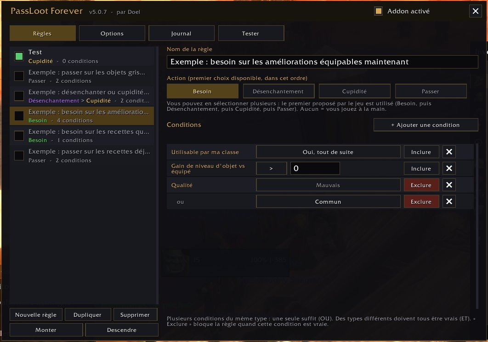

# PassLoot Forever

[English](README.md) | Français

Refonte complète de **PassLoot** (nebula169) pour **World of Warcraft: Forever** (interface 16001).
Même fonction première : jouer automatiquement **Besoin / Désenchantement / Cupidité / Passer** sur le butin de groupe, selon vos règles.

**Auteur de cette version : Doel** - d'après PassLoot, par nebula169.

## Installation

Copiez le dossier `PassLootForever` dans le dossier AddOns de votre client WoW Forever.
Le nom du dossier doit rester identique au fichier `.toc`. Redémarrez le client si l'addon n'apparaît pas.

## Premiers pas

1. Tapez `/plf diag` : vérifie que les fonctions de jet de butin existent sur votre client.
2. `/plf` ouvre la fenêtre. Elle est aussi accessible via **Options > onglet AddOns > PassLoot Forever** et le bouton de la minicarte.
3. Onglet **Règles** : cinq règles d'exemple sont fournies, **désactivées**. Cochez celles que vous voulez.
4. Onglet **Test** (ou `/plf test <lien|ID>`) : montre quelle règle correspondrait, et pourquoi, sans rien jouer.

Voir `MODE_EMPLOI.md` pour un guide pas à pas.

## Fonctionnement des règles (identique à PassLoot)

- Les règles sont examinées de haut en bas ; **la première qui correspond décide**.
- Dans une règle : plusieurs conditions du **même type** = **OU** ; des types **différents** = **ET** ; « Exclure » = « et PAS ».
- L'action choisie est le premier choix **réellement proposé** par le jeu, dans l'ordre Besoin > Désenchantement > Cupidité > Passer.
  Si la règle correspond mais qu'aucun choix n'est possible, l'objet est ignoré (vous décidez).
- Une règle sans action ne joue jamais. Une règle sans condition s'applique à tous les objets (avertissement affiché).

## Conditions disponibles

Qualité, type d'objet (classe/sous-classe), emplacement, utilisable par ma classe (maintenant / plus tard / jamais),
niveau d'objet, **gain de niveau d'objet vs équipé**, **gain de score de stats vs équipé** (poids des stats par classe et spécialité), **statut de la recette** (pas encore apprise de mon métier / déjà apprise / pas de mon métier),
niveau requis, liaison, nom (contient / exact / commence par / motif), prix de vente (en or), quantité possédée,
option de jet disponible, type d'instance, type de groupe, nom de la zone.

## Commandes

`/plf` fenêtre · `/plf on|off` · `/plf test <lien|ID|nom>` · `/plf profile <nom>` · `/plf diag` · `/plf minimap` (afficher/masquer le bouton de la minicarte) · `/plf debug`  (alias : `/passloot`)

## Langues

Anglais par défaut. Toute l'interface et les messages du chat sont traduits en français sur les clients en français (`frFR`).
Les autres clients utilisent l'anglais.

## Historique

- **5.1.1** : première version stable, après une semaine de bêta (mêmes fonctionnalités que la 5.1.0).
- **5.1.0** : nouvelle condition **Gain de score de stats vs équipé** : compare un objet à votre équipement stat par stat, avec des poids par classe et spécialité (bouton Score de l'onglet Tester, qui affiche aussi le score et son détail) ; `/plf diag` vérifie GetItemStats ; corrections d'affichage pour les grandes polices et certaines résolutions (lignes des options, textes coupés affichés en infobulle, bordures d'1 pixel qui pouvaient disparaître).
- **5.0.7** : onglet Options : phrase d'aide des profils retirée.
- **5.0.6** : **export / import de profils** (onglet Options) : un texte à copier et partager, importé comme nouveau profil ; fenêtre plus haute (onglet Options moins tassé, une ligne de plus dans les listes) ; croix de fermeture parfaitement centrées.
- **5.0.5** : onglet Test : Maj + clic sur un objet met son lien dans la zone et lance le test aussitôt (compatible avec le nouveau système de liens du chat) ; on peut aussi glisser un objet dans la zone ; lien vers le PassLoot d'origine ajouté aux modes d'emploi.
- **5.0.4** : bouton de la minicarte (masquable dans Options ou avec `/plf minimap`) ; mise en page de l'onglet Options corrigée (plus de textes superposés ou coupés) ; crédits simplifiés (PassLoot par nebula169).
- **5.0.3** : filtre **Statut de la recette** (deux règles d'exemple : besoin sur les recettes non apprises de mes métiers, passer sur les recettes connues ou d'un autre métier) ; « Utilisable par ma classe » détecte aussi les objets réservés à une autre classe (ligne « Classes : » en rouge).
- **5.0.2** : crédits (auteur Doel, lien vers l'addon original) ; les conditions d'un même type restent uniquement en **OU** (le bouton ou/et de la 5.0.1 est retiré).
- **5.0.1** : les types d'objets « (OBSOLETE) » ne sont plus proposés.
- **5.0.0** : première version.

## Bon à savoir

- Testé sur le client WoW Forever par l'auteur. Le moteur et l'interface ont aussi été exécutés contre une API WoW simulée (191 vérifications). `/plf diag` indique les fonctions du jeu disponibles sur votre client.
- Règles de butin de Forever (éligibilité du Besoin, délais) : non documentées publiquement ; l'addon lit simplement
  ce que le jeu propose pour chaque jet.
- Le statut de la recette lit le texte de l'objet (« Déjà connu ») et compare avec vos métiers ; il ne tient pas compte du niveau de métier requis.
- Valeurs secrètes : toute valeur secrète est traitée comme absente (jamais comparée, jamais affichée).
- Les anciennes règles de PassLoot (`PassLootDB`) ne sont **pas** importées.
- Non repris de l'original : filtres Spécialisation, Nom du joueur, Guilde, Objet déjà appris (général), Unique, Après victoire,
  sortie LibSink, option « popups multiples » (qui modifiait des tables Blizzard).

## Fichiers

`Locale.lua` (en/fr) · `Core.lua` (API, profils, commandes) · `Share.lua` (export / import de profils) · `Items.lua` (données d'objets, cache asynchrone, lecture des infobulles) · `Stats.lua` (score de stats) ·
`Filters.lua` (conditions) · `Engine.lua` (règles, jets, journal, test) · `UI.lua` (fenêtre) · `Minimap.lua` (bouton de la minicarte).
Aucune dépendance (pas d'Ace3). Lua 5.1 uniquement.
