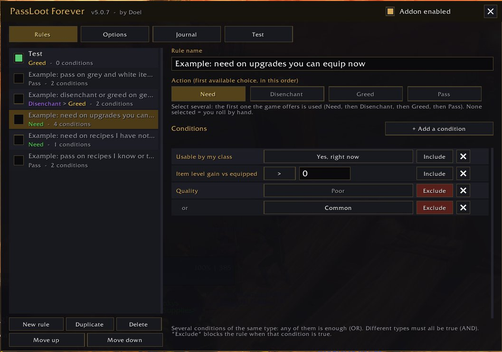

# PassLoot Forever

English | [Français](README.fr.md)

A complete rewrite of **PassLoot** (by nebula169) for **World of Warcraft: Forever** (interface 16001).
Same core purpose: automatically roll **Need / Disenchant / Greed / Pass** on group loot, using your own rules.

**Author of this version: Doel** - based on PassLoot, by nebula169.

## Installation

Copy the `PassLootForever` folder into the AddOns folder of your WoW Forever client.
The folder name must match the `.toc` file name. Restart the client if the addon does not show up.

## Getting started

1. Type `/plf diag`: it checks that the loot-roll functions exist on your client.
2. `/plf` opens the window. It is also available through **Options > AddOns tab > PassLoot Forever** and the minimap button.
3. **Rules** tab: five example rules are provided, **disabled**. Tick the ones you want.
4. **Test** tab (or `/plf test <link|ID>`): shows which rule would match, and why, without rolling anything.

See `USER_GUIDE.md` for a step-by-step guide.

## How rules work (same as PassLoot)

- Rules are checked from top to bottom; **the first one that matches decides**.
- Inside a rule: several conditions of the **same type** = **OR**; **different** types = **AND**; "Exclude" = "and NOT".
- The chosen action is the first choice the game **actually offers**, in the order Need > Disenchant > Greed > Pass.
  If the rule matches but no choice is possible, the item is ignored (you decide).
- A rule without an action never rolls. A rule without conditions applies to every item (a warning is shown).

## Available conditions

Quality, item type (class/subclass), equipment slot, usable by my class (now / later / never),
item level, **item level gain vs equipped**, **recipe status** (not learned yet and my profession / already learned / not my profession),
required level, binding, name (contains / exact / starts with / pattern), vendor price (in gold), amount owned,
roll option available, instance type, group type, zone name.

## Commands

`/plf` window · `/plf on|off` · `/plf test <link|ID|name>` · `/plf profile <name>` · `/plf diag` · `/plf minimap` (show/hide the minimap button) · `/plf debug`  (alias: `/passloot`)

## Languages

English by default. The whole interface and the chat messages are translated into French on French (`frFR`) clients.
Other clients use English.

## Changelog

- **5.0.7**: Options tab: removed the profile help sentence.
- **5.0.6**: profile **export / import** (Options tab): a text to copy and share, imported as a new profile; taller window (less cramped Options tab, one more row in lists); close buttons drawn exactly centred.
- **5.0.5**: Test tab: Shift + click an item puts its link in the box and runs the test right away (works with the newer chat link system); items can also be dragged onto the box; link to the original PassLoot added to the user guides.
- **5.0.4**: minimap button (can be hidden in Options or with `/plf minimap`); Options tab layout fixed (no more overlapping or cut-off text); credits simplified (PassLoot by nebula169).
- **5.0.3**: **Recipe status** filter (two example rules: need on recipes of my professions that I have not learned, pass on recipes I know or that belong to another profession); "Usable by my class" also detects items reserved for another class (red "Classes:" line).
- **5.0.2**: credits (author Doel, link to the original addon); conditions of the same type are OR only (the or/and button from 5.0.1 was removed).
- **5.0.1**: obsolete "(OBSOLETE)" item types are no longer offered.
- **5.0.0**: first version.

## Good to know

- Tested on the WoW Forever client by the author. The engine and the interface were also run against a simulated WoW API (191 checks). `/plf diag` lists the game functions available on your client.
- Forever loot rules (Need eligibility, timers) are not publicly documented; the addon simply reads what the game offers for each roll.
- Recipe status reads the item text ("Already known") and compares it with your professions; it does not take the required profession skill level into account.
- Secret values: any secret value is treated as missing (never compared, never displayed).
- Old PassLoot rules (`PassLootDB`) are **not** imported.
- Not carried over from the original: Specialization, Player name, Guild, Learned item (general), Unique and Loot won filters,
  LibSink output, and the "multiple popups" option (it modified Blizzard tables).

## Files

`Locale.lua` (en/fr) · `Core.lua` (API, profiles, commands) · `Share.lua` (profile export / import) · `Items.lua` (item data, async cache, tooltip reading) ·
`Filters.lua` (conditions) · `Engine.lua` (rules, rolls, journal, test) · `UI.lua` (window) · `Minimap.lua` (minimap button).
No dependencies (no Ace3). Lua 5.1 only.
