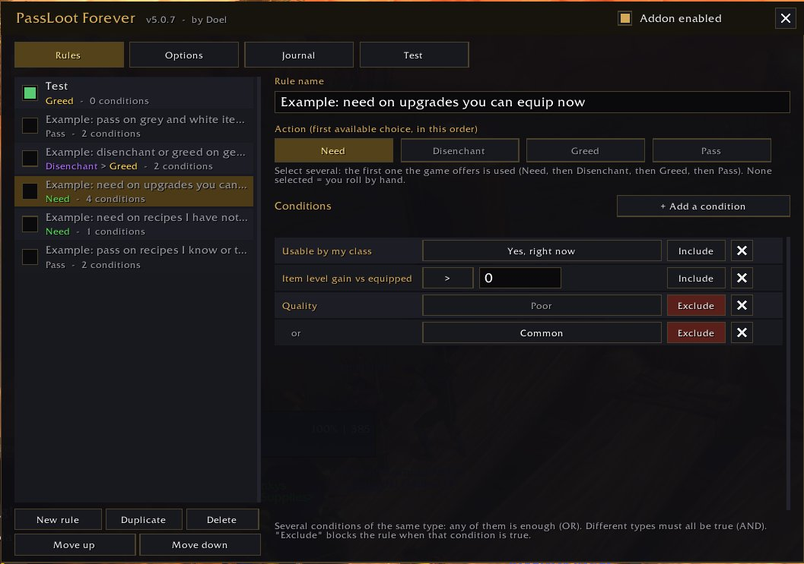
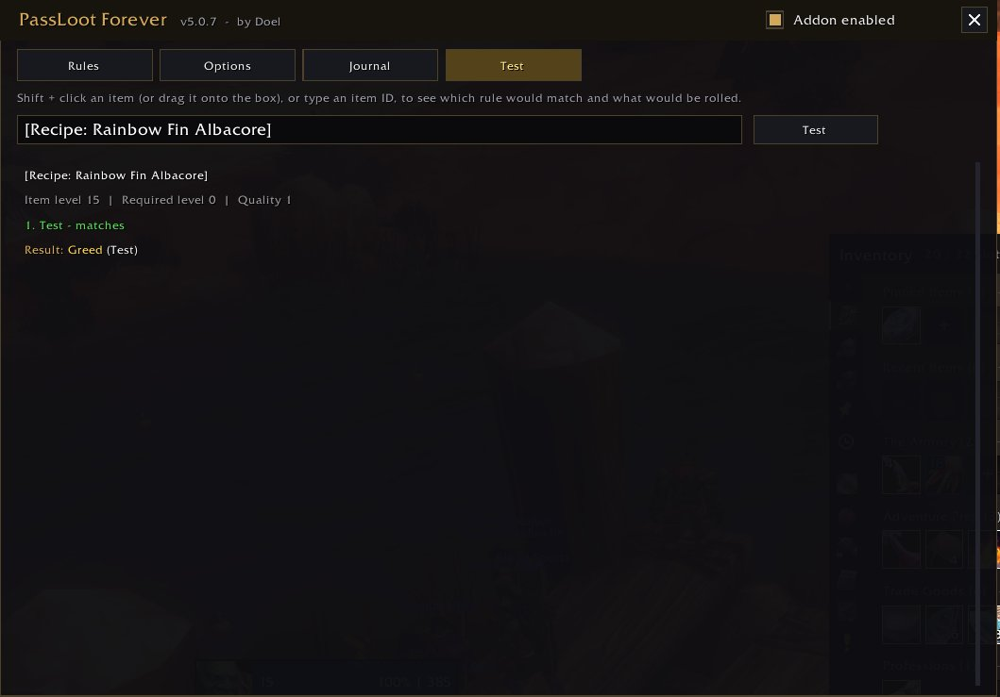
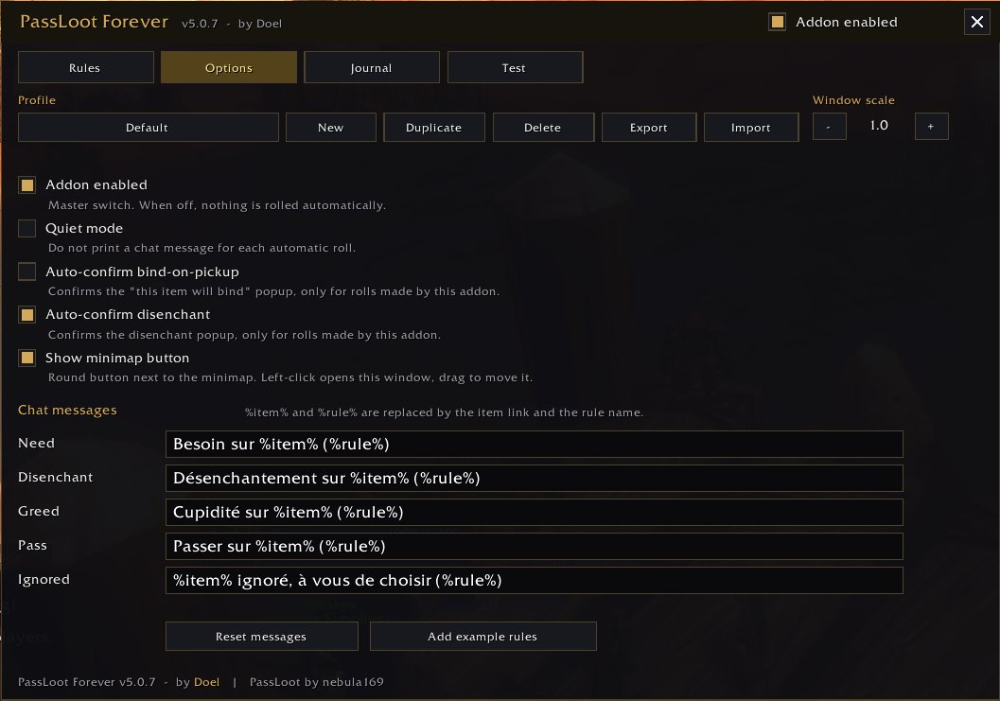

# PassLoot Forever - User Guide

English | [Français](MODE_EMPLOI.md)

PassLoot Forever rolls Need, Disenchant, Greed or Pass **for you** when an item drops in a group,
following rules that you write once. A problem, an idea? Let me know!

## 1. Installation

1. Close the game.
2. Unzip the archive and copy the **PassLootForever** folder into the **AddOns** folder of your WoW Forever client
   (where your other addons are).
3. Start the game. On the character selection screen, check that "PassLoot Forever" is ticked in the addon list.

## 2. First launch: do this first

1. Type **/plf diag** in the chat. The addon checks that the loot-roll functions exist on your client.
   If a line is red ("missing"), take a screenshot and send it to me: it is the most useful thing for me.
2. To see any errors, type **/console scriptErrors 1** (set it back to 0 afterwards if the error windows bother you).
3. Type **/plf** to open the window. The addon is also available through **Options > AddOns tab > PassLoot Forever** or the **minimap button** (left-click).

The addon is in English by default, and fully translated into French on French (frFR) clients.

## 3. Create your first rule (2 minutes)

Example: **automatically pass on all grey and white items.**

1. **Rules** tab, **New rule** button. Type a name, for example "Pass on grey and white".
2. Under **Action**, click **Pass** (the button turns gold).
3. Click **+ Add a condition**, choose **Quality**, then pick **Poor** in the list.
4. Add a second **Quality** condition and pick **Common**.
5. That's it: the rule applies to items of Poor **or** Common quality.

A few things to remember:

- **Several actions** can be selected: the addon uses the first one the game offers, in the order
  Need, then Disenchant, then Greed, then Pass. No action selected = you roll by hand.
- **Several conditions of the same type** (two "Quality"): any one of them is enough (**OR**).
  **Different types** (Quality + Item level): all of them must be true (**AND**).
- **Include / Exclude**: "Exclude" means "unless this condition is true".
- **Rule order**: rules are read from top to bottom, **the first one that matches decides**. Put specific rules
  at the top and general rules at the bottom (Move up / Move down buttons).
- The box on the left of each rule enables or disables it. Five example rules are provided, disabled.
- A rule **without conditions applies to every item**: a red warning is shown.

### Examples: recipes

Two ready-made rules are provided (disabled) in the **Rules** tab, and you can build them yourself:

- **Need on recipes I have not learned**: one **Recipe status** condition = *Not learned yet, my profession*.
- **Pass on recipes I know or that are not for my professions**: two **Recipe status** conditions, *Already learned* **or** *Not my profession* (one is enough).

Recipe status only applies to recipes: there is no need to add "Item type = Recipe" (you can if you prefer).
The addon reads what the game displays on the item ("Already known") and compares it with your professions. It does not look at your profession skill:
a recipe for your profession that is too hard for you right now still counts as "not learned yet, my profession".
Recipe books without a profession ("Book" type) count as being for your profession.

## 4. Test without risk

Before relying on a rule, open the **Test** tab, **Shift + click** an item
(in your bags, on your character, on a chat link...) just like you would to put it in chat, or **drag it** onto the input box:
the test runs right away. You can also type its ID, then click **Test**. The addon tells you which rule would match, why the others do not match,
and what would be rolled, **without rolling anything for real**.
Same thing in chat: `/plf test <link>` (open the window with `/plf`, or via **Options > AddOns tab > PassLoot Forever**, or the minimap button).

## 5. The other tabs

- **Options**: profiles (one per character, with New / Duplicate / Delete / Export / Import), quiet mode (no chat message),
  window scale, minimap button (show / hide), message texts. The two "Auto-confirm" boxes (bind-on-pickup and disenchant)
  are **unticked by default**: tick them only if you are sure of your rules.
- **Sharing a profile** (Options tab): **Export** shows a text that is already selected; press **Ctrl+C**
  and send it to a friend (Discord, text file...). To get it back: **Import**, paste the text with **Ctrl+V**,
  click **Import** and pick a name. A **new profile** is created and selected: your existing profiles
  are never changed. Also handy to keep a backup of your rules.
- **Journal**: the latest automatic rolls of the session, with the rule that decided. Hover an item to see it.

## 6. Commands

| Command | Effect |
|---|---|
| `/plf` | open or close the window (also via **Options > AddOns tab > PassLoot Forever** or the minimap button) |
| `/plf minimap` | show or hide the minimap button |
| `/plf on`, `/plf off` | enable or disable the addon (master switch) |
| `/plf test <link or ID>` | see what would be rolled |
| `/plf profile <name>` | switch profile |
| `/plf diag` | check the functions available on your client |
| `/plf debug` | show debug messages |

If in doubt in the middle of a dungeon: **/plf off** and you are back in control immediately (or untick "Addon enabled" in the window, opened with **Options > AddOns tab > PassLoot Forever** or the minimap button).

## 7. What to report to me

- A roll that does not happen, or a wrong choice: send the item link, the rule concerned and the result of
  the **Test** tab.
- A red error message: a full screenshot.
- A display problem (cut-off text, a button that does not respond): a screenshot and your screen size.
- The result of **/plf diag**.

## Good to know

- **Usable by my class** takes into account the armor and weapons your class can wear, your level, and the class
  restrictions that the game writes in red on the item ("Classes: ...").
- When a piece of information cannot be read (item not loaded yet, for example), the conditions concerned **do not match**:
  the addon never guesses, and you keep control of the roll.
- The minimap button can be dragged around the minimap; hide it in the **Options** tab or with `/plf minimap`.
- Old rules from the original PassLoot addon are not imported.

---
PassLoot Forever, by **Doel**. Based on PassLoot, by nebula169. Original addon on CurseForge: <https://www.curseforge.com/wow/addons/pass-loot>.
